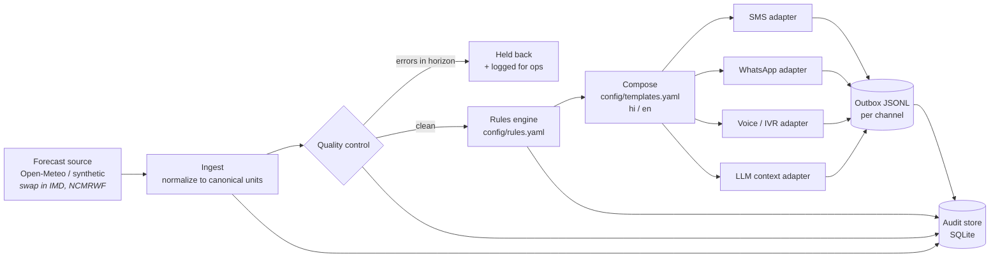

# agri-forecast-pipeline

An automated pipeline that turns numerical weather forecasts into location-specific,
multi-language advisories for smallholder farmers, rendered for several dissemination
channels at once (SMS, WhatsApp, voice/IVR, and LLM-powered advisory assistants).

It is built around three questions any forecast-to-farmer system must answer:

1. **Is the forecast data trustworthy enough to act on?** Automated quality control
   holds back a location rather than send a message based on bad data.
2. **What should a farmer actually do?** Declarative, auditable rules translate
   forecast numbers into advice, using IMD rainfall and heat-wave categories.
3. **How does each channel need to receive it?** Channel adapters handle SMS encoding
   limits, WhatsApp templates, text-to-speech scripts, and structured LLM context.

Replicating to a new geography is a configuration change, not a code change: the repo
ships with two regions (Uttar Pradesh and Bihar) that run on identical code.

---

## Architecture



| Stage | Module | Input → Output |
|---|---|---|
| Ingest | `ingest.py` | Region locations → raw payload (kept) + `DailyForecast` records |
| Quality control | `qc.py` | Records → clean records per location, blocked locations, issues |
| Decision logic | `rules.py` | Clean records → prioritized `Advisory` list with rule ids |
| Composition | `messages.py` | Advisories → localized sentences |
| Channels | `channels.py` | One composed message → one vendor-ready payload per channel |
| Orchestration | `run.py` | Runs the stages, times each one, writes outbox, report, audit trail |

Every stage speaks the same small set of types (`models.py`), which is what makes
sources and channels swappable.

---

## Quick start

```bash
pip install -r requirements-dev.txt

# Offline demo with deterministic synthetic forecasts (no network needed)
PYTHONPATH=src python -m pipeline.run --region config/regions/up_pilot.yaml --source synthetic

# Live forecast for today from Open-Meteo
PYTHONPATH=src python -m pipeline.run --region config/regions/up_pilot.yaml --source open-meteo

# Tests (add RUN_LIVE=1 to include the live API test)
python -m pytest -v
```

Each run writes `outbox/<run_id>/` containing one JSONL file per channel plus a
human-readable `run_report.md`, and appends to `data/audit.sqlite`.
Sample outputs from both regions are committed in [`examples/outbox/`](examples/outbox/).

**Exit codes** let a scheduler alert on problems: `0` ok, `1` failed (e.g. forecast
source unreachable), `2` degraded (QC held back more than 20% of locations).

---

## Decision logic

Rules live in [`config/rules.yaml`](config/rules.yaml), not in code. Each rule has an id,
a severity, a priority, a scope, and conditions. Every message records which rule ids
produced it, so any advisory a farmer received can be traced to the exact threshold
and forecast values behind it.

| Advisory | Condition | Basis |
|---|---|---|
| Very heavy rain | ≥ 115.6 mm/day | IMD rainfall category |
| Heavy rain | ≥ 64.5 mm/day | IMD rainfall category |
| Moderate rain | ≥ 15.6 mm/day and probability ≥ 60% | IMD category + confidence gate |
| Heat wave | Tmax ≥ 45 °C | IMD absolute heat-wave criterion (plains) |
| Very hot | Tmax ≥ 40 °C | IMD threshold for considering heat-wave conditions |
| Strong wind | max wind ≥ 40 km/h | Agronomic placeholder |
| Frost risk | Tmin ≤ 4 °C | Agronomic placeholder |
| Dry spell | < 2.5 mm over the horizon and Tmax ≥ 30 °C | Agronomic placeholder |
| Spray window | dry, calm, < 35 °C, no rain the next day | Agronomic placeholder |

Placeholders are explicitly marked in the config; in practice they are set and
validated by the field research team.

**Scopes.** `any_day` rules fire on the earliest qualifying day in the 3-day horizon.
`horizon` rules evaluate aggregates (sum, max, min) and refuse to fire on a partial
horizon, since a "no rain for 3 days" claim based on 2 days of data is misleading.

**Suppression is day-aware.** A stronger advisory silences a weaker one only from
its own day onward. Without this, "very heavy rain the day after tomorrow" would hide
"heavy rain tomorrow", removing the one day of lead time farmers most need.
(This was a real bug found on the first run; there is a regression test for it.)

**Missing data never triggers advice.** A null value fails every condition, so the
pipeline cannot, for example, report "no rain expected" because a value is missing.

---

## Quality control

For time-sensitive advice, **a wrong message is worse than a late one.**

| Check | Catches |
|---|---|
| completeness | location returned fewer days than requested |
| freshness | first forecast day is not the run date (stale feed) |
| missing | a required variable is null |
| range | physically impossible values (bounds in `rules.yaml`) |
| consistency | Tmin above Tmax |

An error on any day **inside** the advisory horizon holds back the whole location:
no message goes out, and the issue is logged in the run report and audit store.
Problems **outside** the horizon are warnings only; the bad day is dropped and the
rest of the location's forecast is still used. The synthetic source injects a
corrupted record on every run, so this path is exercised continuously.

---

## Channels

Each dissemination system ingests data differently, so channel logic is isolated
in adapters. Adding a vendor means adding one class and one line of region config.

**SMS.** Encoding matters more than most people expect. Hindi (Devanagari) forces
UCS-2, which allows 70 characters per segment instead of GSM-7's 160. A single `°`
also forces UCS-2, because it is not in the GSM-7 character set. The adapter:

- substitutes `°C → C` only when that keeps the message in GSM-7;
- degrades gracefully in order of information lost: full text → **headline mode**
  (only the "what and when" sentence of each advisory, so every warning survives)
  → dropping whole advisories, lowest priority first;
- never truncates mid-sentence, since a cut-off warning can change meaning.

**WhatsApp.** WhatsApp Business requires pre-approved templates for outbound
messages, so the advisory text is passed as template parameters.

**Voice / IVR.** A text-to-speech script that repeats the most important advisory
at the end (listeners cannot re-read a call), with an estimated call duration.

**LLM context.** Instead of free text, an LLM advisory assistant receives the
forecast numbers, each advisory with its rule id and approved wording, units, and
grounding instructions. This lets its answers be grounded in, and audited against,
the same data as every other channel.

**Reliability properties shared by all channels:**

- `message_id` is a content hash, so a retried run cannot double-send a message.
- `expires_at` is 23:59 IST on the run date. Messages say "today" and "tomorrow",
  and after midnight those words refer to the wrong day, so anything unsent by then
  must be dropped.
- The pipeline writes an outbox rather than calling vendor APIs directly. Sending is
  a separate consumer, so a slow or failing vendor cannot stall forecast processing.

---

## Replicating to a new geography

Everything location-specific lives in `config/regions/<region>.yaml`: locations,
coordinates, local place names, default language, and the channel mix with
per-channel options. Compare the two shipped regions:

| | Uttar Pradesh | Bihar |
|---|---|---|
| Locations | 5 districts | 4 districts |
| Languages | Hindi | Hindi + one English unit |
| Channels | SMS (3 segments), WhatsApp, voice, LLM | Voice, SMS (2 segments) |
| Code changes | none | none |

To add a region: copy a region file, edit it, and add its name to the matrix in
`.github/workflows/daily_forecast.yml`. To add a language: add a block to
`config/templates.yaml`. If a template is missing, the pipeline falls back to
English and records a warning rather than failing silently.

To add a forecast source: implement one class with a `fetch()` method that returns
raw payloads, plus a parser to the canonical `DailyForecast` fields.

---

## Operations

- **Scheduling.** `.github/workflows/daily_forecast.yml` runs every region daily at
  05:55 IST, in parallel, with `fail-fast: false` so one region's failure does not
  block the others. The run report is published to the job summary, and outputs
  and the audit database are kept as artifacts for 30 days.
- **Latency.** Each stage is timed and the timings are recorded per run. Ingest
  makes one batched API request for all locations rather than one per location.
- **Audit.** `data/audit.sqlite` stores runs, raw payloads, parsed forecasts, QC
  issues, and every message with its rule ids. This answers "what did district X
  receive on date Y, and why?" The schema maps directly onto Postgres or BigQuery.
- **Retries.** The live source retries with exponential backoff; a final failure
  marks the run `failed` (exit 1) rather than producing partial output.

---

## Limitations and what production would need

- **Data source.** Open-Meteo's free tier is for non-commercial use. A production
  system would ingest IMD / NCMRWF products behind the same `ForecastSource` interface.
- **Point vs. area forecasts.** Locations are district centroids. A district is
  heterogeneous, so production use would aggregate gridded forecasts over block or
  village polygons (e.g. area-weighted mean or a high percentile for rainfall).
- **Deterministic vs. probabilistic.** Rules use a single deterministic forecast.
  Ensemble forecasts would allow rules like "probability of exceeding 64.5 mm ≥ 50%",
  which communicates uncertainty more honestly and can be calibrated against observations.
- **Verification.** There is no feedback loop yet comparing advisories with observed
  weather (hit rate, false alarm rate per rule), which is how thresholds should be tuned.
- **Wording.** Hindi templates are a draft and need native-speaker and field review.
  Agronomic thresholds are placeholders pending field-research validation.
- **Ordering.** Advisories are ordered by priority, so "very heavy rain day after
  tomorrow" can appear before "heavy rain tomorrow". Whether farmers understand
  priority order or chronological order better is a question for field testing.
- **Sending.** Vendor delivery, delivery receipts, and opt-outs are out of scope;
  the outbox is the hand-off point.

---

## Repository layout

```
config/
  rules.yaml              decision rules, thresholds, QC bounds
  templates.yaml          farmer-facing wording per language
  regions/*.yaml          locations + channel mix per geography
src/pipeline/
  models.py               shared data contracts
  ingest.py               forecast sources + parser
  qc.py                   quality control
  rules.py                declarative rules engine
  messages.py             localized composition
  channels.py             SMS / WhatsApp / voice / LLM adapters
  store.py                SQLite audit trail
  run.py                  orchestrator + run report
tests/                    34 tests: boundaries, QC policy, encoding, end-to-end
examples/outbox/          sample outputs for both regions
.github/workflows/        CI tests + daily scheduled run
```
